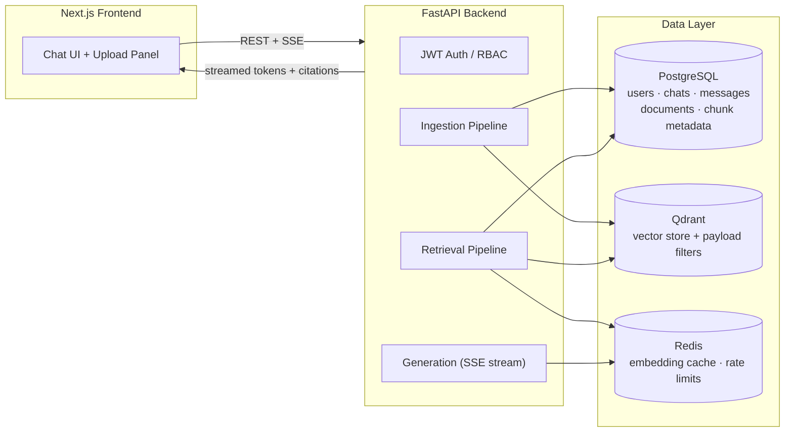
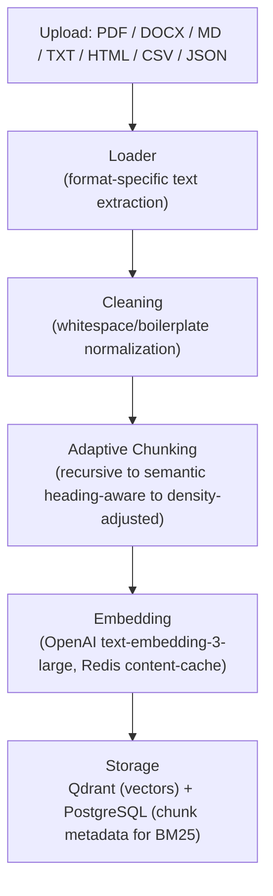
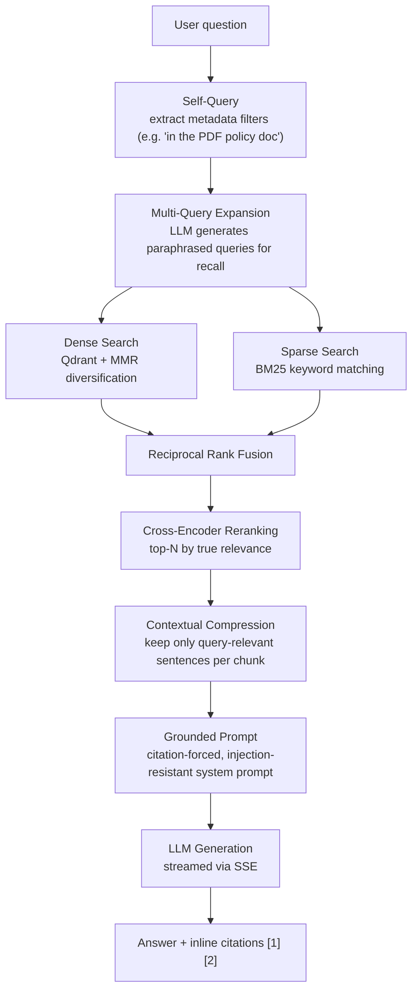
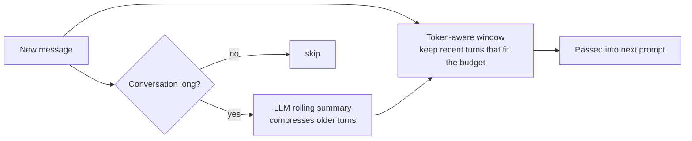

# AI Customer Support Copilot

A Retrieval-Augmented Generation (RAG) system that answers customer/agent support
questions grounded in a company's own documents — product docs, policies, API
references, release notes — instead of relying on an LLM's raw knowledge. Every
answer is streamed in real time and cited back to its source chunk.

Built to demonstrate a production-shaped RAG stack: hybrid retrieval, reranking,
context compression, conversation memory, and a streaming full-stack app — not a
single-file PDF chatbot.

**Live demo:** _add your deployed link here_
**Repo:** https://github.com/OmkarMishra56/Rag-Copilot

---

## What it does

A user drags in a PDF, DOCX, Markdown, HTML, CSV, or JSON file. The system parses,
chunks, and embeds it, then makes it queryable in natural language through a chat
interface. Answers are grounded only in the retrieved content, streamed token-by-token,
and annotated with clickable citations back to the source document and chunk.

---

## System architecture



---

## RAG pipeline

This is the core of the project — how a raw document becomes a grounded, cited answer.

### 1. Ingestion (document → searchable chunks)



### 2. Retrieval + Generation (question → grounded answer)



**Why each stage exists:**
- **Self-query** — lets a question like "what does the PDF say about refunds" filter to just that source before searching.
- **Multi-query expansion** — a single phrasing of a question misses semantically-similar chunks; generating paraphrases improves recall.
- **Hybrid (dense + sparse) + RRF** — dense embeddings catch meaning, BM25 catches exact keywords/product names/error codes that embeddings can blur; fusing both beats either alone.
- **MMR** — without it, top-k dense results are often near-duplicates of the same paragraph; MMR trades a little relevance for diversity of context.
- **Reranking** — the embedding model that's fast enough to search 100k+ chunks isn't the same model that's accurate enough to rank the final few; a cross-encoder re-scores the shortlist directly against the query.
- **Contextual compression** — trims each chunk to its relevant sentences before it hits the prompt, cutting token cost and reducing the chance the LLM answers from an irrelevant part of a long chunk.
- **Citation-forced prompting** — the system prompt requires every claim to reference a numbered source, and explicitly instructs the model to refuse rather than fabricate when context is insufficient.

### 3. Conversation memory



---

## Tech stack

| Layer | Choice |
|---|---|
| Frontend | Next.js 14 (App Router), TypeScript, TailwindCSS, SSE streaming |
| Backend | FastAPI, Python 3.12, Pydantic v2, async SQLAlchemy |
| Vector DB | Qdrant — payload-indexed metadata filtering |
| Relational DB | PostgreSQL — users, chats, messages, document/chunk metadata |
| Cache | Redis — embedding cache, rate limiting |
| LLM / Embeddings | OpenAI GPT-4.1 + text-embedding-3-large (swappable interface) |
| Reranker | Cross-encoder (`ms-marco-MiniLM-L-6-v2`, swappable to `bge-reranker-large`/Cohere) |
| Auth | JWT + bcrypt, role-based access control |
| Infra | Docker Compose, Nginx reverse proxy, GitHub Actions CI |

## Key engineering decisions

- **Repository pattern + dependency injection** for the data layer, so retrieval/ingestion logic doesn't touch SQLAlchemy directly — easier to test and to swap storage later.
- **Content-addressed embedding cache** in Redis — re-uploading a revised document doesn't re-embed unchanged chunks.
- **Streaming from end to end** — the backend streams tokens over SSE as the LLM generates them; the frontend renders markdown/code incrementally rather than waiting for the full response.
- **Prompt-injection awareness** — retrieved document content and user input are both treated as untrusted; the system prompt is the only source of behavioral instructions, and a heuristic flags likely injection attempts for logging.
- **Evaluation harness** (`eval/run_eval.py`) — retrieval precision/recall against a golden dataset, plus LLM-judged faithfulness and answer relevancy, so retrieval quality is measurable, not assumed.

## Running it locally

```bash
git clone https://github.com/OmkarMishra56/Rag-Copilot && cd rag-copilot
cp backend/.env.example backend/.env  
docker compose up --build
```

- App: `http://localhost:3000`
- API docs: `http://localhost:8000/docs`

## Testing

```bash
cd backend && pip install -r requirements.txt && pytest -v
```

Unit tests cover chunking correctness (size limits, heading preservation, parent/child
linkage) and security utilities (PII masking, prompt-injection detection, JWT/password
handling), plus an API smoke test.

## Roadmap

Scoped deliberately — this is what's next, not what's missing by accident:
Kubernetes/Terraform deployment, full observability (LangSmith tracing, Grafana
dashboards), per-document RBAC enforcement, Confluence/Notion/GitHub ingestion,
Alembic-managed migrations.
